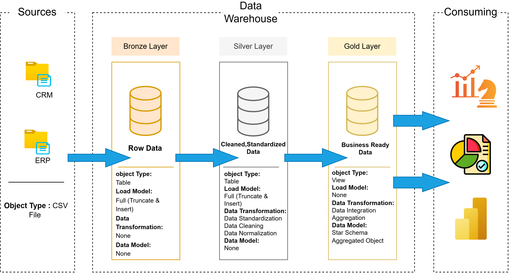

# sql-data-warehouse-project
Welcome to the SQL Data Warehouse repository! 👋

This is my first data warehouse project, and I am glad to share it with you.

📌 About the Project

A SQL Server data warehouse project that integrates CRM and ERP source data into a centralized analytical database using the **Medallion Architecture**.

The project demonstrates an end-to-end SQL data warehousing workflow, from raw data ingestion and transformation to dimensional modeling and data quality validation.

## Project Overview

Organizations often store customer, product, and sales information across separate operational systems. Integrating these sources into a consistent structure makes data easier to manage and prepares it for analysis and reporting.

The objective of this project is to build a centralized SQL Server Data Warehouse that consolidates CRM and ERP data into business-ready datasets.

## Architecture

The project follows the Medallion Architecture, organizing data into three layers:

| Layer | Description |
|---|---|
| **Bronze** | Stores raw data loaded from CRM and ERP CSV files. |
| **Silver** | Cleans, standardizes, and transforms the raw data. |
| **Gold** | Provides business-ready views organized into a dimensional model. |



### Data Flow

1. Extract source data from CRM and ERP files.
2. Load raw records into Bronze tables.
3. Transform and standardize data in the Silver layer.
4. Integrate customer and product information from multiple sources.
5. Create Gold dimension and fact views for analytical use.
6. Perform data quality checks to validate the transformed data.

## Data Model

The Gold layer contains a star-schema-style model with two dimension views and one fact view.

| Object | Type | Description | Grain |
|---|---|---|---|
| `gold.dim_customers` | Dimension | Customer attributes integrated from CRM and ERP | One row per customer |
| `gold.dim_products` | Dimension | Product attributes and category information | One row per current product |
| `gold.fact_sales` | Fact | Sales transactions linked to customer and product dimensions | One row per sales order line |


## Technical Implementation

The project covers the following SQL Server concepts and techniques:

- **Database Design:** Creating the data warehouse database and Bronze, Silver, and Gold schemas.
- **Data Ingestion:** Loading CSV files using `BULK INSERT` and stored procedures.
- **ETL Development:** Implementing full-load procedures using `TRUNCATE` and `INSERT` operations.
- **Data Transformation:** Cleaning, standardizing, and integrating data using SQL queries, joins, conditional logic, and date transformations.
- **Dimensional Modeling:** Building customer and product dimensions, a sales fact view, and surrogate keys.
- **Error Handling:** Using `TRY...CATCH` blocks to handle errors during loading.
- **Performance Monitoring:** Tracking execution time during data loading.
- **Data Quality:** Writing SQL checks to identify issues such as duplicates, null values, and invalid relationships.

## Repository Structure

```text
sql-data-warehouse-project/
│
├── datasets/
│   ├── crm/
│   └── erp/
│
├── docs/
│   ├── Data Catalog.docx
│   ├── Data Linage.drawio.png
│   ├── Data Mart.png
│   ├── Integration_model_gold.png
│   └── Process.png
│
├── scripts/
│   ├── bronze/
│   │   ├── ddl_bronze.SQL
│   │   └── proc_bronze_load.SQL
│   │
│   ├── silver/
│   │   ├── ddl_silver.sql
│   │   └── proc_load_silver.sql
│   │
│   ├── gold/
│   │   └── ddl_gold.sql
│   │
│   ├── test/
│   │   └── quality_checks_silver.sql
│   │
│   └── database.SQL
│
└── README.md
```

## Documentation

The repository includes supporting documentation to explain the data warehouse design:

- [Data Catalog](docs/Data%20Catalog.docx) – Describes the Gold-layer objects, columns, business definitions, sources, and transformation rules.
- [Data Lineage](docs/Data%20Linage.drawio.png) – Illustrates how source data flows through the warehouse.
- [Data Mart](docs/Data%20Mart.png) – Shows the dimensional model.
- [Gold Integration Model](docs/Integration_model_gold.png) – Illustrates how source systems are integrated into the Gold layer.
- [Process Diagram](docs/Process.png) – Provides an overview of the project workflow.

## Tools and Technologies

- Microsoft SQL Server
- SQL (T-SQL)
- SQL Server Management Studio (SSMS)
- CSV source files

**Important:** The database creation script drops and recreates an existing `DataWarehouse` database. Do not run it against a database containing data you need to preserve.

## Learning Source

This project was developed while following a data warehousing course by **Baraa Courses** on YouTube. The course provided the initial structure and learning direction; this repository represents my practical implementation and work with SQL Server data warehousing concepts.
